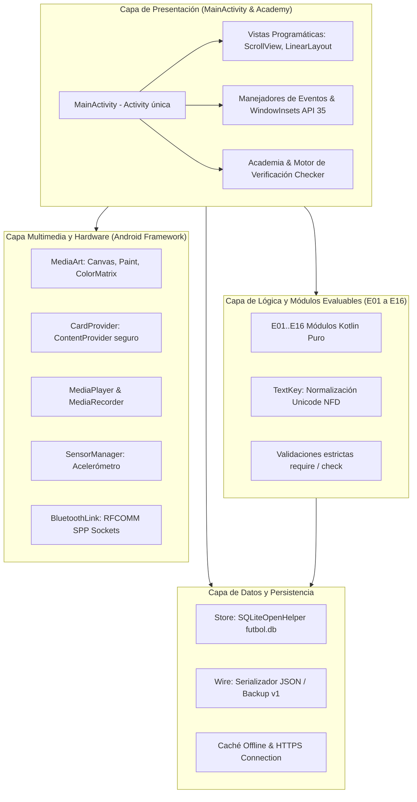
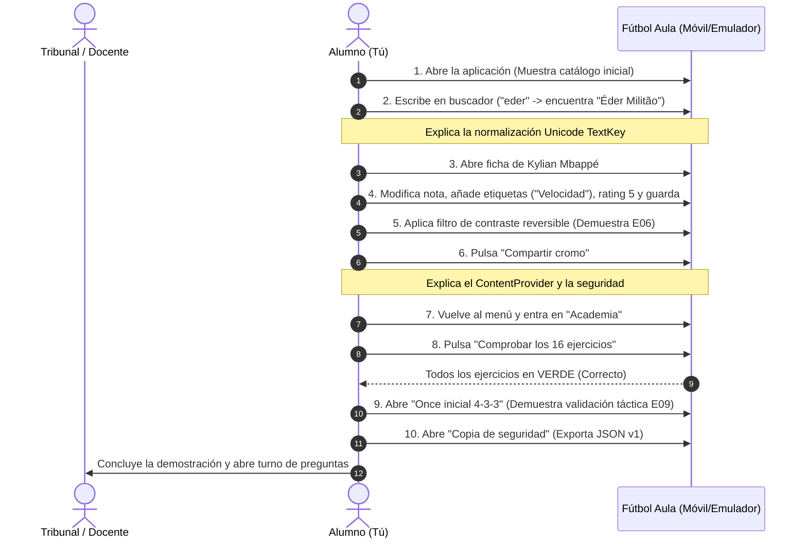

# GUÍA DEFINITIVA PARA LA DEFENSA DEL PROYECTO: FÚTBOL AULA (v2.1)
**Módulo:** Programación Multimedia y Dispositivos Móviles (PMDM)  
**Ciclo Formativo:** Desarrollo de Aplicaciones Multiplataforma (DAM)  
**Resultados de Aprendizaje Cubiertos:** RA2 (Dispositivos Móviles) y RA3 (Multimedia)  
**Entorno Tecnológico:** Kotlin 2.0.21 · AGP 8.7.3 · Gradle 8.9 · JDK 17 · Android SDK 35 (minSdk 26)

---

## ÍNDICE DE CONTENIDOS
1. [Resumen Ejecutivo y "Elevator Pitch" (1-2 Minutos)](#1-resumen-ejecutivo-y-elevator-pitch)
2. [Arquitectura Global y Organización del Código](#2-arquitectura-global-y-organización-del-código)
3. [Componentes Principales del Sistema](#3-componentes-principales-del-sistema)
4. [Análisis Técnico de los 16 Módulos Evaluables (E01 a E16)](#4-análisis-técnico-de-los-16-módulos-evaluables-e01-a-e16)
5. [Banco de Preguntas del Tribunal: De lo Básico a lo Complejo](#5-banco-de-preguntas-del-tribunal)
   - [Bloque 1: Fundamentos de Android y Kotlin (Nivel Básico)](#bloque-1-fundamentos-de-android-y-kotlin-nivel-básico)
   - [Bloque 2: Persistencia, Sensores, Concurrencia y Ciclo de Vida (Nivel Intermedio)](#bloque-2-persistencia-sensores-concurrencia-y-ciclo-de-vida-nivel-intermedio)
   - [Bloque 3: Seguridad, Red, Hardware y Casos Extremos (Nivel Avanzado/Trampa)](#bloque-3-seguridad-red-hardware-y-casos-extremos-nivel-avanzadotrampa)
6. [Matriz de Trazabilidad Curricular Oficial (RA2 y RA3)](#6-matriz-de-trazabilidad-curricular-oficial-ra2-y-ra3)
7. [Guion de Demostración Práctica en Vivo (Live Demo)](#7-guion-de-demostración-práctica-en-vivo-live-demo)
8. [Plan de Contingencia y Respuestas Rápidas ante Errores](#8-plan-de-contingencia-y-respuestas-rápidas-ante-errores)

---

## 1. RESUMEN EJECUTIVO Y "ELEVATOR PITCH"

### ¿Qué es Fútbol Aula?
**Fútbol Aula** es una aplicación nativa para Android desarrollada en **Kotlin**, concebida como una plataforma integral de gestión, coleccionismo y análisis multimedia de futbolistas. La aplicación combina funcionalidades de gestión de datos relacionales, procesamiento gráfico avanzado, captura y reproducción de audio, interacción con sensores de movimiento (acelerómetro), sincronización con servicios web remotos y comunicación inalámbrica punto a punto mediante **Bluetooth SPP**.

### Discurso de apertura recomendado para iniciar la defensa:
> *"Buenos días / tardes. Presento **Fútbol Aula (v2.1)**, un proyecto desarrollado en **Kotlin nativo** bajo **Android SDK 35** que integra de forma transversal todos los criterios de los Resultados de Aprendizaje 2 y 3 de Programación Multimedia y Dispositivos Móviles.*
>
> *El proyecto no es un simple CRUD: implementa una arquitectura robusta orientada a contratos, con interfaz gráfica fluida construida programáticamente en Kotlin, persistencia atómica mediante SQLite y transacciones ACID, un **ContentProvider** propio para la compartición segura de imágenes mediante URIs temporales, procesamiento de gráficos sobre **Canvas** y filtros de matriz de color reversibles, grabación y reproducción de notas de voz sincronizadas, integración de acelerómetro con debouncing para eventos de sacudida, comunicación serie por Bluetooth con protocolo de confirmación ACK y control de tiempo de espera (Watchdog), y sincronización HTTPS con tolerancia a fallos mediante caché local sin conexión.*
>
> *Además, la aplicación incluye **Academia**, un entorno de autoevaluación integrado con un motor de verificación en Kotlin puro (**Checker.kt**) que ejecuta en tiempo real pruebas unitarias sobre casos normales, casos límite y casos de error de los 16 módulos evaluables sin depender de frameworks externos."*

---

## 2. ARQUITECTURA GLOBAL Y ORGANIZACIÓN DEL CÓDIGO

### Diagrama de Flujo y Capas



### Características arquitectónicas distintivas
1. **Interfaz Declarativa/Programática en Kotlin puro:** En lugar de inflar archivos XML para cada pantalla, `MainActivity` construye la jerarquía de vistas dinámicamente mediante funciones de ayuda (`screen`, `text`, `button`, `input`, `spinner`). Esto elimina el overhead de `findViewById`/ViewBinding, reduce el tamaño del APK y asegura transiciones de pantalla instantáneas.
2. **Separación de Responsabilidades e Inmutabilidad:** Los modelos de datos (`Player`, `Mark`, `Question`, `CacheResult`) son `data class` inmutables. Toda modificación se realiza mediante copias (`copy()`), garantizando la ausencia de efectos secundarios no controlados.
3. **Módulos desacoplados del Framework de Android:** La lógica de negocio y las validaciones de los 16 evaluables (`E01` a `E16`) y el comprobador (`Checker.kt`) residen en objetos `object` de Kotlin estándar, sin llamadas al framework de Android. Esto permite que se puedan ejecutar idénticamente tanto en pruebas locales JUnit en la JVM (`testDebugUnitTest`) como dentro de la aplicación móvil.

---

## 3. COMPONENTES PRINCIPALES DEL SISTEMA

### 1. `MainActivity.kt` — El Controlador Central
- **Herencia y Roles:** Hereda de `Activity` e implementa `SensorEventListener`.
- **Manejo del Ciclo de Vida:**
  - `onCreate()`: Inicializa SQLite (`Store`), `SensorManager`, recupera el estado guardado (`savedInstanceState`) y enruta hacia el catálogo o la ficha de jugador seleccionada.
  - `onResume()`: Registra el listener del acelerómetro con retraso `SENSOR_DELAY_UI`.
  - `onPause()`: Cancela el registro del sensor, libera el `MediaPlayer` y aborta de forma segura grabaciones no confirmadas para no dejar archivos huérfanos.
  - `onDestroy()`: Cancela animaciones activas, cierra sockets Bluetooth (`link.close()`), detiene hilos de fondo (`worker.shutdown()`) y asegura la liberación total de recursos.
  - `onSaveInstanceState()`: Preserva en el Bundle los filtros de búsqueda (`query`, `club`, `onlyFavorites`) y el ID del jugador seleccionado ante rotaciones de pantalla o muerte del proceso por el sistema.
- **Concurrencia Segura:** Dispone de un `ExecutorService` de un solo hilo (`worker = Executors.newSingleThreadExecutor()`). Toda tarea pesada (red, I/O, Bluetooth) se ejecuta en `worker.execute { ... }` y los resultados se devuelven a la interfaz mediante `runOnUiThread { ... }`, previniendo congelamientos de pantalla (ANRs) y excepciones de hilo.

### 2. `Store.kt` — Persistencia Local SQLite
- **Gestor:** Extiende `SQLiteOpenHelper`, gestionando la base de datos `futbol.db` (versión 1).
- **Tablas:**
  - `marks(id INTEGER PRIMARY KEY, favorite INTEGER NOT NULL, note TEXT NOT NULL, tags TEXT NOT NULL, rating INTEGER NOT NULL)`
  - `settings(key TEXT PRIMARY KEY, value TEXT NOT NULL)`
- **Transacciones ACID:** El método `restore()` utiliza bloques `beginTransaction()`, `setTransactionSuccessful()` y `endTransaction()` dentro de un bloque `try-finally`. Esto garantiza que, si una restauración de copia de seguridad falla en el registro 50, se efectúe un rollback completo sin dejar la base de datos en un estado inconsistente.

### 3. `Models.kt`, `Seed.kt` y `TextKey` — Dominio y Normalización
- **`Player`:** Modelo que representa a un futbolista (`id`, `name`, `club`, `position`, `source`).
- **`Mark`:** Anotaciones personales del usuario (`favorite`, `note`, `tags`, `rating`).
- **`TextKey.of(value)`:** Función de normalización de cadenas de texto clave para la aplicación. Realiza:
  $$\text{Normalizer.normalize}(text, \text{Normalizer.Form.NFD}).\text{replace}("\\p\{M\}+", "").\text{lowercase}()$$
  Esto descompone los caracteres acentuados en carácter base + diacrítico, elimina los diacríticos mediante expresiones regulares y pasa a minúsculas. Así, `"Éder Militão"` coincide con `"eder militao"`, evitando discrepancias en búsquedas y ordenaciones.

### 4. `MediaArt.kt` — Procesamiento Gráfico y Canvas
- **Generación de Cromos:** Dibuja dinámicamente un cromo de $900 \times 1100$ píxeles sobre un `Bitmap.Config.ARGB_8888`.
- **Cálculo de Texto Dinámico:** Para evitar que nombres largos desborden el ancho de la tarjeta, implementa un bucle que mide el ancho con `Paint.measureText()` y reduce progresivamente el tamaño de fuente (`paint.textSize`) hasta ajustarse al límite de 820 px.
- **Filtros de Color:** Emplea `ColorMatrix` y `ColorMatrixColorFilter`. La saturación $0$ produce escala de grises. El contraste utiliza una matriz de transformación afín $4\times5$.

### 5. `CardProvider.kt` — ContentProvider Seguro
- **Autoridad:** `es.aula.futbol.cards`, declarado en `AndroidManifest.xml` con `android:exported="false"` y `android:grantUriPermissions="true"`.
- **Mecanismo:** En lugar de exponer rutas del sistema de archivos, implementa `openFile(uri, mode)` abriendo un `ParcelFileDescriptor` en modo solo lectura (`"r"`), y `query()` devolviendo un `MatrixCursor` con las columnas `OpenableColumns.DISPLAY_NAME` y `OpenableColumns.SIZE`.
- **Seguridad:** Restringe el acceso estrictamente a `/cromo.png`. Cualquier otra ruta lanza `IllegalArgumentException("Ruta no autorizada")`.

### 6. `BluetoothLink.kt` — Comunicación Punto a Punto RFCOMM
- **Estándar:** Bluetooth clásico SPP (Serial Port Profile) con UUID universal `00001101-0000-1000-8000-00805F9B34FB`.
- **Arquitectura Cliente/Servidor:**
  - Emisor: Conecta mediante `BluetoothDevice.createRfcommSocketToServiceRecord(uuid)`.
  - Receptor: Escucha mediante `adapter.listenUsingRfcommWithServiceRecord("FutbolAula", uuid)` con un timeout de aceptación de 25 segundos.
- **Mecanismo Watchdog:** Utiliza un `ScheduledExecutorService` que fuerza el cierre del socket tras 20 segundos (envío) o 30 segundos (recepción) si el canal se queda bloqueado.
- **Handshake:** Tras enviar los IDs de la colección en JSON, el receptor valida la carga útil y responde con un mensaje `"ACK\n"`. El emisor no da por completado el envío hasta recibir dicha confirmación.

### 7. `Checker.kt` — Motor de Pruebas Integrado en la App
- **Propósito:** Permite verificar los 16 contratos directamente en la pantalla "Academia" sin necesidad de un ordenador ni de compilar tests JUnit.
- **Estados:** `PENDIENTE` (la función lanza `NotImplementedError` por el `TODO`), `CORRECTO` (supera todos los casos normales, límite y rechazo) e `INCORRECTO` (algún caso devuelve un valor erróneo o no lanza la excepción requerida).
- **Manejo de Casos:** Evalúa funciones lambda con `run(name) { action() }` capturando `AssertionError`, informando con precisión qué condición ha fallado.

---

## 4. ANÁLISIS TÉCNICO DE LOS 16 MÓDULOS EVALUABLES (E01 A E16)

Esta sección cubre el contrato exacto, lógica y casos de prueba de cada ejercicio resuelto en `es.aula.futbol.evaluables`:

```
┌─────────┬───────────────────────────────┬────────────────────────────────────────────────────────┐
│ Módulo  │ Título                        │ Función Principal y Contrato Clave                     │
├─────────┼───────────────────────────────┼────────────────────────────────────────────────────────┤
│ E01     │ Más equipos reales            │ addTeam(current, incoming): List<Player>               │
│ E02     │ Buscar, filtrar y ordenar     │ filter(rows, query, club, pos, favs, onlyFavs, desc)   │
│ E03     │ Etiquetas y valoración        │ mark(original, tags, rating): Mark                     │
│ E04     │ Comparar fichas               │ compare(rows): String                                  │
│ E05     │ Sorpresa respetando filtros   │ choose(candidates, index): Player?                     │
│ E06     │ Contraste reversible          │ parameters(value): Pair<Float, Float>                  │
│ E07     │ Imagen persistente            │ filename(id, extension): String                        │
│ E08     │ Playlist y comentarios voz    │ next(current, size, direction): Int?                   │
│ E09     │ Once inicial 4-3-3            │ validate(rows): Boolean                                │
│ E10     │ Colecciones múltiples         │ add(names, name): List<String>                         │
│ E11     │ Copia de seguridad validada   │ restore(current, text, known): Map<Int, Mark>          │
│ E12     │ Datos guardados sin conexión  │ resolve(remote, saved, error): CacheResult             │
│ E13     │ Reto de cinco preguntas       │ build(rows, count): List<Question>                     │
│ E14     │ Diseñar y compartir cromo     │ title(raw, color): String                              │
│ E15     │ Intercambio con confirmación  │ decode(text, known): List<Int>                         │
│ E16     │ Panel de mi colección         │ counts(rows): Map<String, Int>                         │
└─────────┴───────────────────────────────┴────────────────────────────────────────────────────────┘
```

---

### E01 · Más equipos reales (`E01Catalogo.kt`)
- **Objetivo:** Añadir un lote nuevo de futbolistas al catálogo general validando integridad referencial.
- **Firma:** `fun addTeam(current: List<Player>, incoming: List<Player>): List<Player>`
- **Reglas del Contrato:**
  1. `incoming` no puede estar vacío (`require(incoming.isNotEmpty())`).
  2. Todo el lote debe pertenecer a un único club (`distinct().size == 1` normalizado con `TextKey.of`).
  3. Cada jugador debe tener `id > 0`, nombre y club no vacíos, posición dentro de las 4 oficiales (`"Portero"`, `"Defensa"`, `"Centrocampista"`, `"Delantero"`) y `source` obligatoriamente HTTPS (`startsWith("https://")`).
  4. Ningún ID del lote puede estar repetido dentro del lote ni existir previamente en `current`.
  5. Ningún jugador puede duplicarse en identidad (mismo nombre normalizado y mismo club normalizado), aunque intente entrar con otro ID.
- **Caso Límite:** Si un lote falla en el 5º jugador, la función lanza excepción y no modifica `current` (operación atómica).

---

### E02 · Buscar, filtrar y ordenar (`E02Filtros.kt`)
- **Objetivo:** Filtrado multicriterio simultáneo y ordenación alfabética.
- **Firma:** `fun filter(rows: List<Player>, query: String, club: String, position: String, favorites: Set<Int>, onlyFavorites: Boolean, descending: Boolean): List<Player>`
- **Reglas del Contrato:**
  1. La búsqueda por texto (`query`) se realiza insensible a acentos y mayúsculas (`TextKey.of(p.name).contains(key)`).
  2. Todos los filtros son acumulativos (lógica `AND`): club exacto (o todos si está vacío), posición exacta (o todas si vacía), y favoritos (si `onlyFavorites == true`, el ID debe estar en el conjunto `favorites`).
  3. Ordenación por nombre normalizado: si `descending == true`, invierte el resultado ordenado con `.reversed()`.
- **Caso Límite:** Consulta vacía y filtros en blanco deben devolver todo el catálogo ordenado de la A a la Z.

---

### E03 · Etiquetas y valoración personal (`E03Etiquetas.kt`)
- **Objetivo:** Gestión de metadatos del usuario sobre una ficha.
- **Firma:** `fun mark(original: Mark, tags: List<String>, rating: Int): Mark`
- **Reglas del Contrato:**
  1. `rating` debe estar estrictamente en el rango `0..5` (`require(rating in 0..5)`).
  2. Cada etiqueta se recorta de espacios con `.trim()` y se descartan las cadenas vacías.
  3. Se deduplican las etiquetas ignorando tildes y mayúsculas (`distinctBy { TextKey.of(it) }`). Por ejemplo, `"Técnica"` y `"tecnica"` cuentan como una sola.
  4. Máximo 5 etiquetas resultantes, cada una con un máximo de 24 caracteres.
  5. Devuelve `original.copy(tags = clean, rating = rating)`, preservando intactos el favorito y la nota preexistente.

---

### E04 · Comparar fichas sin inventar datos (`E04Comparador.kt`)
- **Objetivo:** Comparación objetiva de identidad y posición entre jugadores.
- **Firma:** `fun compare(rows: List<Player>): String`
- **Reglas del Contrato:**
  1. Debe recibir entre 2 y 4 jugadores (`require(rows.size in 2..4)`).
  2. Todos los jugadores deben ser distintos por ID (`rows.map { it.id }.distinct().size == rows.size`).
  3. La salida es un string con formato `"${it.name} | ${it.club} | ${it.position}"` separado por saltos de línea.
  4. **Principio ético:** Jamás inventa puntuaciones numéricas ni declara a un jugador "mejor" que otro.

---

### E05 · Sorpresa respetando filtros (`E05Sensor.kt`)
- **Objetivo:** Selección aleatoria/circular de un jugador entre los resultados visibles al sacudir el dispositivo.
- **Firma:** `fun choose(candidates: List<Player>, index: Int): Player?`
- **Reglas del Contrato:**
  1. Si `candidates` está vacío, devuelve `null` de forma segura (sin excepciones).
  2. El índice debe dar la vuelta de forma circular. Para manejar correctamente tanto números grandes como números **negativos**, se utiliza `Math.floorMod(index, candidates.size)`.
  3. Solo puede seleccionar jugadores que ya estén en la lista `candidates` (respeta los filtros activos en pantalla).

---

### E06 · Filtro de contraste reversible (`E06Contraste.kt`)
- **Objetivo:** Calcular la matriz de transformación de color para el ajuste de contraste fotográfico.
- **Firma:** `fun parameters(value: Float): Pair<Float, Float>`
- **Reglas del Contrato:**
  1. `value` debe ser finito (rechaza `NaN` e infinito) y estar en el rango `0.0f..3.0f`.
  2. La fórmula matemática es:
     $$\text{escala} = \text{value}, \quad \text{desplazamiento (offset)} = 128 \times (1 - \text{value})$$
  3. Con `value = 1.0f`, la escala es 1 y el offset es 0 (imagen idéntica al original, **filtro neutro**).
  4. Con `value = 0.0f`, la escala es 0 y el offset es 128 (gris medio puro).
  5. Permite volver al original en cualquier momento sin perder la imagen base.

---

### E07 · Imagen persistente por jugador (`E07Imagen.kt`)
- **Objetivo:** Generar el nombre de archivo seguro para almacenar la foto de un futbolista.
- **Firma:** `fun filename(id: Int, extension: String): String`
- **Reglas del Contrato:**
  1. `id` debe ser un entero positivo (`id > 0`).
  2. La extensión debe pertenecer exclusivamente al conjunto permitido: `extension in setOf("png", "jpg")`.
  3. Formato resultante: `"jugador_$id.$extension"`.
  4. **Seguridad:** Al construir la cadena a partir de un entero validado y una extensión de lista cerrada, es matemáticamente imposible inyectar secuencias de salto de directorio (`../` o rutas absolutas `/etc/`).

---

### E08 · Playlist y comentarios de voz (`E08Audio.kt`)
- **Objetivo:** Navegación circular por la lista de pistas de audio y grabaciones de voz.
- **Firma:** `fun next(current: Int, size: Int, direction: Int): Int?`
- **Reglas del Contrato:**
  1. `direction` solo puede ser `-1` (anterior) o `1` (siguiente).
  2. `size` debe ser $\ge 0$. Si `size == 0`, devuelve `null`.
  3. `current` debe ser un índice válido dentro de la lista (`current in 0 until size`).
  4. La navegación es circular: desde el índice 0 con dirección -1 salta al último (`size - 1`). Se implementa con `Math.floorMod(current + direction, size)`.

---

### E09 · Once inicial 4-3-3 (`E09Alineacion.kt`)
- **Objetivo:** Validación estricta de una alineación táctica de fútbol.
- **Firma:** `fun validate(rows: List<Player>): Boolean`
- **Reglas del Contrato:**
  1. Debe tener exactamente 11 futbolistas y todos con ID diferente.
  2. Agrupa por posición (`groupingBy { it.position }.eachCount()`) y verifica la distribución táctica 4-3-3:
     - 1 Portero
     - 4 Defensas
     - 3 Centrocampistas
     - 3 Delanteros
  3. Si la lista tiene menos de 11 jugadores, repetidos o cualquier otra distribución, devuelve `false`. **Nunca lanza excepción**.

---

### E10 · Colecciones múltiples (`E10Colecciones.kt`)
- **Objetivo:** Gestión de nombres de colecciones personalizadas sin duplicidades semánticas.
- **Firma:** `fun add(names: List<String>, name: String): List<String>`
- **Reglas del Contrato:**
  1. Se recorta el nombre con `.trim()`. Longitud obligatoria entre 1 y 40 caracteres.
  2. Para evitar colecciones equivalentes, se calcula una clave eliminando espacios en blanco y normalizando con `TextKey.of`:
     $$\text{key}(t) = \text{TextKey.of}(t).\text{replace}("\\s+", "")$$
  3. Si ya existe un nombre con la misma clave (ej. `"Mis Favoritos"` frente a `"mis favoritos "` o `"Mís Favoritos"`), se rechaza con error.
  4. Devuelve la lista existente más el nuevo nombre recortado (`names + clean`).

---

### E11 · Copia de seguridad validada (`E11Copia.kt`)
- **Objetivo:** Restauración segura y transaccional de un backup JSON de marcas personales.
- **Firma:** `fun restore(current: Map<Int, Mark>, text: String, known: Set<Int>): Map<Int, Mark>`
- **Reglas del Contrato:**
  1. Valida primero el documento completo mediante `Wire.decode(text, known)`.
  2. Si el JSON está mal formado o no cumple el esquema v1, lanza excepción y no altera ningún dato.
  3. Los registros que correspondan a IDs desconocidos en este dispositivo (`not in known`) se ignoran silenciosamente.
  4. La copia v1 solo transporta `favorite` y `note`. Al restaurar, se combinan con `current`, actualizando el favorito y la nota pero **conservando las etiquetas (`tags`) y la valoración (`rating`)** que el usuario ya tuviera localmente.

---

### E12 · Datos guardados sin conexión (`E12Cache.kt`)
- **Objetivo:** Política de tolerancia a fallos de conectividad en el catálogo remoto.
- **Firma:** `fun resolve(remote: List<Player>?, saved: List<Player>, error: String?): CacheResult`
- **Reglas del Contrato:**
  1. Si `remote != null` y no hay error (`error == null`): éxito. Devuelve los datos remotos con `stale = false` y mensaje `"Actualizado"`.
  2. Si la conexión falla (timeout, sin red, error 500): fallback inmediato a `saved` con `stale = true` (datos caducados) y un mensaje descriptivo indicando cuántos jugadores guardados se están mostrando.
  3. Si no hay red ni tampoco había nada guardado en caché: lista vacía con `stale = true` y mensaje informativo. **La aplicación nunca se cuelga ni muestra pantallas en blanco**.

---

### E13 · Reto de cinco preguntas (`E13Quiz.kt`)
- **Objetivo:** Generación procedural de un cuestionario de preguntas sobre clubes de fútbol.
- **Firma:** `fun build(rows: List<Player>, count: Int): List<Question>`
- **Reglas del Contrato:**
  1. `count > 0` y el catálogo debe tener al menos `count` futbolistas (`rows.size >= count`) sin IDs duplicados.
  2. El catálogo debe incluir al menos 2 clubes distintos para poder generar opciones falsas (distractores).
  3. Cada pregunta toma a un jugador distinto (`rows.take(count)`): texto `"¿Dónde juega ${player.name}?"`.
  4. Las opciones son exactamente 2: el club correcto y un distractor (un club diferente elegido rotativamente). Las opciones se mezclan con `.shuffled()`.

---

### E14 · Diseñar y compartir cromo (`E14Cromo.kt`)
- **Objetivo:** Validación y sanitización del título para el renderizado del cromo exportable.
- **Firma:** `fun title(raw: String, color: Int): String`
- **Reglas del Contrato:**
  1. `color` debe estar estrictamente en el rango `0..2` (0: Azul marino, 1: Violeta, 2: Verde botella).
  2. `raw` se recorta de espacios en los extremos con `.trim()`. Longitud obligatoria entre 1 y 28 caracteres.
  3. Devuelve el título limpio listo para ser dibujado por `MediaArt.card()`.

---

### E15 · Intercambio con confirmación (`E15Bluetooth.kt`)
- **Objetivo:** Deserialización y validación del protocolo de paquetes recibidos por Bluetooth SPP.
- **Firma:** `fun decode(text: String, known: Set<Int>): List<Int>`
- **Reglas del Contrato:**
  1. Tamaño del mensaje en bytes UTF-8 $\le 8192$ bytes (previene ataques de denegación de servicio por memoria).
  2. Esquema JSON: `{"version": 1, "ids": [...]}`. La versión debe ser exactamente 1.
  3. La lista de IDs no puede estar vacía.
  4. Cada elemento debe ser de tipo entero estricto (`require(value is Int)`).
  5. No puede contener IDs repetidos (`ids.distinct().size == ids.size`).
  6. Todos los IDs deben pertenecer al catálogo local conocido (`ids.all { it in known }`). Si se recibe un ID que este móvil no tiene en su catálogo, el mensaje se rechaza para evitar corrupciones.

---

### E16 · Panel de mi colección (`E16Panel.kt`)
- **Objetivo:** Agregación estadística de la colección por entidad deportiva.
- **Firma:** `fun counts(rows: List<Player>): Map<String, Int>`
- **Reglas del Contrato:**
  1. Elimina duplicados por ID (`rows.distinctBy { it.id }`) para que un jugador no compute doble.
  2. Agrupa por club y cuenta los integrantes (`groupingBy { it.club }.eachCount()`).
  3. Ordena el mapa alfabéticamente por el nombre del club (`.toSortedMap()`).
  4. Si `rows` está vacío, devuelve un mapa vacío sin errores.

---

## 5. BANCO DE PREGUNTAS DEL TRIBUNAL

Este banco de preguntas está clasificado por nivel de complejidad, abarcando desde las preguntas rutinarias de código hasta las trampas técnicas de arquitectura, seguridad y hardware.

---

### BLOQUE 1: FUNDAMENTOS DE ANDROID Y KOTLIN (NIVEL BÁSICO)

#### P1: ¿Por qué la interfaz gráfica está construida en código Kotlin en lugar de usar archivos XML o Jetpack Compose?
> **Respuesta:**
> *"Se optó por una construcción programática directa en Kotlin mediante vistas nativas (`LinearLayout`, `ScrollView`, `TextView`, etc.) por varias razones arquitectónicas:*
> 1. *Permite una aplicación ultra-ligera, sin overhead de compilación ni generación de clases ViewBinding/DataBinding.*
> 2. *Permite que la pantalla 'Academia' construya dinámicamente controles en tiempo real para 16 ejercicios distintos leyendo los archivos de `assets`.*
> 3. *Facilita un control absoluto del ciclo de vida y de los `WindowInsets` de Android 15 (SDK 35), gestionando el padding de las barras del sistema de forma limpia.*
> 4. *Todo el flujo de eventos y vistas queda centralizado, facilitando la trazabilidad y la depuración sin saltos de contexto entre ficheros XML y clases Kotlin."*

#### P2: ¿Qué ocurre exactamente con la aplicación al girar la pantalla y cómo lo gestionas?
> **Respuesta:**
> *"Al rotar la pantalla, el sistema destruye la Activity (`onDestroy`) y crea una nueva instancia (`onCreate`).*
> *Para evitar la pérdida de contexto, en `onSaveInstanceState(outState)` persisto:*
> - *La consulta de búsqueda (`query`).*
> - *El filtro de club (`club`).*
> - *El estado del checkbox de favoritos (`onlyFavorites`).*
> - *El ID del jugador actualmente seleccionado (`selected?.id`).*
>
> *En `onCreate(savedInstanceState)`, si `savedInstanceState != null`, recupero esos datos. Si había un jugador seleccionado, reabro automáticamente su ficha (`detail(p)`); de lo contrario, muestro el catálogo restaurando los filtros.*
> *Las notas no guardadas en el `EditText` se descartan intencionadamente por diseño si el usuario no pulsó 'Guardar', tal como especifica la documentación de límites."*

#### P3: ¿Por qué en Kotlin usas `data class` para `Player` y `Mark`, y `object` para `E01Catalogo` o `MediaArt`?
> **Respuesta:**
> - *`data class`: Genera automáticamente los métodos `equals()`, `hashCode()`, `toString()`, `componentN()` y muy especialmente el método `copy()`. Esto nos permite tratar los datos de manera inmutable (por ejemplo, en `E03Etiquetas`: `original.copy(tags = clean, rating = rating)`).*
> - *`object`: En Kotlin declara un **Singleton**. Asegura que solo exista una única instancia estática en memoria para las utilidades de transformación y módulos de lógica, ahorrando asignaciones de memoria en el recolector de basura.*

#### P4: ¿Cuál es la diferencia entre `require()` y `check()` en Kotlin y cuándo se usa cada uno?
> **Respuesta:**
> - *`require(condición) { "mensaje" }`: Valida los **argumentos de entrada** recibidos por la función. Si la condición es falsa, lanza un `IllegalArgumentException`. Se usa en todos los evaluables para verificar que el llamador no envíe datos no admitidos.*
> - *`check(condición) { "mensaje" }`: Valida el **estado interno** del sistema o el resultado de una operación. Si falla, lanza un `IllegalStateException`. Se usa, por ejemplo, en `MediaArt.save` para comprobar que la compresión del bitmap (`bitmap.compress(...)`) devolvió `true`.*

#### P5: ¿Qué permisos solicita la aplicación en el `AndroidManifest.xml` y por qué NO solicita el permiso `CAMERA` ni permisos de almacenamiento (`READ_EXTERNAL_STORAGE`)?
> **Respuesta:**
> *"La app declara:*
> - *`INTERNET`: Permiso normal (sin diálogo en tiempo de ejecución).*
> - *`RECORD_AUDIO`: Permiso peligroso para grabar notas de voz personales (solicitado en tiempo de ejecución con `requestPermissions`).*
> - *`BLUETOOTH_CONNECT`: Declarado con compatibilidad `BLUETOOTH` (maxSdkVersion 30) y `BLUETOOTH_CONNECT` para Android 12+ (API 31+).*
>
> *Y **NO solicita** `CAMERA` porque la captura de fotografías no la realiza nuestra app directamente, sino que delegamos mediante un Intent implícito (`MediaStore.ACTION_IMAGE_CAPTURE`) a la aplicación de cámara del sistema del usuario. La cámara externa nos devuelve la miniatura en `onActivityResult`.*
> *Tampoco solicita permisos de almacenamiento general porque se utiliza el **almacenamiento interno privado** de la app (`context.filesDir` y `context.cacheDir`), y para seleccionar imágenes externas se usa el selector del sistema (`Intent.ACTION_OPEN_DOCUMENT`), el cual concede acceso temporal exclusivo sobre el URI seleccionado sin invadir la privacidad del usuario."*

---

### BLOQUE 2: PERSISTENCIA, SENSORES, CONCURRENCIA Y CICLO DE VIDA (NIVEL INTERMEDIO)

#### P6: ¿Cómo evitas un ANR (Application Not Responding) en operaciones lentas como red o Bluetooth?
> **Respuesta:**
> *"Android prohíbe terminantemente realizar operaciones de red o I/O en el hilo principal (`Main Thread` / UI Thread), lo que causaría la excepción `NetworkOnMainThreadException` o congelaría la interfaz generando un ANR.*
> *En `MainActivity` implemento un ejecutor de un solo hilo:*
> ```kotlin
> private val worker = Executors.newSingleThreadExecutor()
> ```
> *La función de utilidad `task { ... }` envía la operación costosa al hilo secundario mediante `worker.execute { ... }`. Una vez obtenido el resultado, llamo a `runOnUiThread { ... }` para actualizar los elementos visuales de la interfaz de forma segura, verificando antes `!isDestroyed` para evitar excepciones si la Activity se cerró mientras la tarea terminaba."*

#### P7: ¿Por qué es fundamental el uso de transacciones en `Store.restore()`?
> **Respuesta:**
> *"Al restaurar una copia de seguridad (`restore`), podemos tener cientos de registros que insertar en SQLite. Si ejecutamos cada `save()` de forma individual, SQLite abriría y cerraría el diario de transacciones del disco en cada registro, siendo extremadamente lento.*
> *Al envolverlo en:*
> ```kotlin
> writableDatabase.beginTransaction()
> try {
>     data.forEach { (id, m) -> save(id, m) }
>     writableDatabase.setTransactionSuccessful()
> } finally {
>     writableDatabase.endTransaction()
> }
> ```
> 1. *Logramos velocidad: todas las escrituras se consolidan en una sola operación física en disco.*
> 2. *Garantizamos **atomicidad (ACID)**: Si el proceso se interrumpe a mitad, la base de datos realiza un rollback completo y no queda en un estado corrupto o a medio guardar."*

#### P8: ¿Cómo funciona la detección de sacudida (Shake) con el acelerómetro en `onSensorChanged`?
> **Respuesta:**
> *"La Activity implementa `SensorEventListener`. Al registrar el acelerómetro (`Sensor.TYPE_ACCELEROMETER`), el método `onSensorChanged(event)` recibe periódicamente las fuerzas de aceleración en los ejes $X$, $Y$ y $Z$ en metros por segundo al cuadrado ($m/s^2$):*
> ```kotlin
> val x = event.values[0]; val y = event.values[1]; val z = event.values[2]
> val g = Math.sqrt((x*x + y*y + z*z).toDouble()) / SensorManager.GRAVITY_EARTH
> ```
> *Dividimos el módulo del vector de aceleración entre la gravedad de la Tierra ($9.80665 \, m/s^2$) para obtener la fuerza $G$.*
> *Si la fuerza supera el umbral de $2.5 \, G$ y han transcurrido más de $900 \, ms$ desde la última sacudida (mecanismo de **debouncing / enfriamiento**), se dispara la selección de un jugador sorpresa mediante `E05Sensor.choose`. Este retraso evita que un solo movimiento dispare 20 selecciones consecutivas."*

#### P9: ¿Por qué se utiliza `Math.floorMod` en lugar del operador `%` de Kotlin en `E05Sensor` y `E08Audio`?
> **Respuesta:**
> *"Esta es una trampa clásica en la programación. En Kotlin y Java, el operador `%` no es la operación matemática de módulo, sino el **resto de la división truncada**. Esto significa que si el dividendo es negativo, el resultado es negativo:*
> $$-1 \% 3 = -1$$
> *Si intentamos acceder a `candidates[-1]`, la aplicación lanza un `IndexOutOfBoundsException` y se cuelga.*
> *En cambio, `Math.floorMod(-1, 3)` implementa la división de suelo matemática y devuelve **2**, permitiendo que un desplazamiento hacia atrás (`direction = -1`) en el primer elemento de la lista salte circularmente al último elemento de forma robusta."*

#### P10: ¿Qué pasa con una grabación de audio si el usuario recibe una llamada o minimiza la app mientras grababa?
> **Respuesta:**
> *"En el ciclo de vida de la Activity, al pasar a segundo plano se ejecuta `onPause()`. Dentro de `onPause()` llamamos a:*
> ```kotlin
> stopRecording(save = false)
> releaseAudio()
> ```
> *La función `stopRecording(save = false)` detiene el `MediaRecorder` y borra inmediatamente el archivo temporal del disco (`recordingFile?.delete()`).*
> *Esto es una decisión deliberada de diseño: una nota de voz solo se consolida si el usuario pulsa explícitamente 'Guardar nota de voz'. Si la app se pausa, el audio inconcluso se descarta para no dejar archivos basura en el almacenamiento ni audios a medio grabar."*

---

### BLOQUE 3: SEGURIDAD, RED, HARDWARE Y CASOS EXTREMOS (NIVEL AVANZADO/TRAMPA)

#### P11: ¿Por qué se implementó un `ContentProvider` propio (`CardProvider`) en lugar de usar un Intent directo con la ruta del fichero o `FileProvider`?
> **Respuesta:**
> *"Desde Android 7.0 (API 24) rige la política de **Scoped Storage** y la prohibición estricta de compartir URIs con esquema de archivo (`file://`), lo que provocaría un `FileUriExposedException`.*
> *Para compartir el cromo con WhatsApp, Gmail u otras apps, se necesita un URI con esquema de contenido (`content://`). Aunque se podría usar el `FileProvider` genérico de AndroidX, implementar `CardProvider` heredando de `ContentProvider` demuestra:*
> 1. *Dominio interno de la arquitectura de proveedores de contenidos de Android.*
> 2. *Seguridad máxima: se sobrescribe `openFile()` validando estrictamente que la ruta sea `/cromo.png` y en modo solo lectura (`"r"`), bloqueando cualquier intento de manipulación indebida.*
> 3. *Implementación de `query()` con `MatrixCursor` exponiendo exclusivamente el nombre y tamaño del archivo sin filtrar datos internos del sistema."*

#### P12: ¿Cómo previene `E07Imagen` un ataque de Path Traversal (recorrido de directorios)?
> **Respuesta:**
> *"Un ataque de Path Traversal ocurre cuando un usuario malintencionado pasa nombres de archivo como `../../etc/hosts` para sobreescribir o leer archivos críticos del sistema operativo.*
> *En `E07Imagen.filename(id, extension)`:*
> - *El identificador se valida como entero positivo (`require(id > 0)`).*
> - *La extensión se comprueba contra una lista blanca cerrada: `extension in setOf("png", "jpg")`.*
>
> *Al construir el nombre concatenando `jugador_$id.$extension`, es imposible que la cadena resultante contenga barras inclinadas (`/` o `\`) o secuencias de salto de directorio (`..`). El nombre resultante es estrictamente un nombre de archivo plano."*

#### P13: ¿Cómo funciona el protocolo de comunicación Bluetooth SPP en `BluetoothLink` y cómo se gestiona una caída del enlace?
> **Respuesta:**
> *"La comunicación utiliza el perfil de puerto serie (SPP) sobre RFCOMM, que emula un flujo de datos serie bidireccional.*
> *El protocolo consta de 3 fases:*
> 1. *Apertura de socket y conexión al UUID estándar `00001101-0000-1000-8000-00805F9B34FB`.*
> 2. *Transmisión del mensaje JSON con la colección de IDs finalizada en un salto de línea (`\n`).*
> 3. *Recepción del acuse de recibo (`ACK\n`) devuelto por el receptor tras validar el contenido mediante `E15Bluetooth.decode`.*
>
> *Para evitar que la app quede congelada si el otro móvil se apaga, se aleja o nunca responde, `BluetoothLink` crea un temporizador con `ScheduledExecutorService` (Watchdog):*
> - *En el emisor: tras 20 segundos se invoca automáticamente `cancel()`, cerrando el socket y arrojando una excepción controlada.*
> - *En el receptor: el socket de escucha tiene un timeout de aceptación de 25 segundos y un watchdog global de 30 segundos.*
> *Cualquier desconexión o fallo cierra ambos sockets en los bloques `finally`, garantizando la liberación de los recursos del hardware Bluetooth."*

#### P14: En el filtro de contraste (E06), ¿cuál es la deducción matemática de la fórmula `offset = 128 * (1 - value)`?
> **Respuesta:**
> *"El contraste modifica la pendiente de los valores de luminosidad respecto al punto medio de la escala de color (el gris medio, cuyo valor en RGB de 8 bits es 128).*
> *La transformación lineal para cada canal de color $C \in [0, 255]$ es:*
> $$C' = \text{escala} \times (C - 128) + 128$$
> *Desarrollando algebraicamente la expresión:*
> $$C' = \text{escala} \times C - \text{escala} \times 128 + 128$$
> $$C' = \text{escala} \times C + 128 \times (1 - \text{escala})$$
> *En una matriz de color `ColorMatrix`, la transformación afín aplica $C' = \text{scale} \times C + \text{offset}$. Por tanto:*
> $$\text{offset} = 128 \times (1 - \text{value})$$
> *Esta fórmula asegura que:*
> - *Si $\text{value} = 1$, $\text{offset} = 0$, resultando $C' = 1 \times C + 0 = C$ (identidad perfecta).*
> - *Si $\text{value} = 0$, $\text{offset} = 128$, resultando $C' = 0 \times C + 128 = 128$ (la imagen se convierte uniformemente en un plano gris medio).*
> - *Cualquier valor superior a 1 amplifica la diferencia entre luces y sombras respecto al centro 128."*

#### P15: ¿Cómo garantiza `E12Cache` que la aplicación siga operativa cuando no hay conexión a Internet?
> **Respuesta:**
> *"La función `E12Cache.resolve(remote, saved, error)` implementa el patrón **Offline First** (tolerancia a fallos de conectividad):*
> - *Si la llamada HTTP devolvió datos válidos (`remote != null` y `error == null`), se muestran los datos actualizados y `stale = false`.*
> - *Si la llamada lanzó un `SocketTimeoutException` o no hay cobertura (`remote == null`), la función examina los datos guardados en SQLite (`saved`). Si hay datos en caché, los devuelve marcando `stale = true` y genera un mensaje informativo para el usuario: `'Sin conexión: mostrando X jugadores guardados'`.*
> - *Si tampoco hubiera nada guardado, devuelve una lista vacía sin excepciones.*
> *De este modo, la aplicación jamás muestra una pantalla de error abrupta ni interrumpe la navegación del usuario."*

#### P16: ¿Cuál es la diferencia entre los tests ejecutados con `testDebugUnitTest` y los ejecutados con `connectedDebugAndroidTest`?
> **Respuesta:**
> - *`testDebugUnitTest` (Tests Unitarios Locales): Se ejecutan en la máquina de desarrollo sobre la **JVM de escritorio** (OpenJDK 17). No necesitan emulador ni dispositivo físico. Utilizan stubs de Android proporcionados por el plugin de Gradle. En nuestro proyecto ejecutan los 64 tests de `BaseTest`, `CheckerTest` y los tests de los evaluables `E01Test` a `E16Test`.*
> - *`connectedDebugAndroidTest` (Tests Instrumentados): Requieren obligatoriamente un emulador Android o un móvil físico conectado por ADB. Se compilan en un APK de test separado (`app-debug-androidTest.apk`) y se inyectan en el entorno real de Android con `AndroidJUnitRunner` y `Espresso`. En nuestro proyecto prueban la persistencia real en disco de SQLite (`PersistenceTest`) y el arranque real de la interfaz gráfica (`SmokeTest`)."*

---

## 6. MATRIZ DE TRAZABILIDAD CURRICULAR OFICIAL (RA2 Y RA3)

Esta tabla demuestra qué parte del código respalda cada criterio de evaluación oficial de la asignatura:

| Criterio Curricular | Descripción Oficial | Evidencia en el Código de Fútbol Aula |
|---|---|---|
| **RA2 a** | Arquitectura y componentes móviles | `MainActivity.kt`, `Store.kt`, `MediaArt.kt`, `BluetoothLink.kt`, 16 módulos evaluables y modelos inmutables. |
| **RA2 b** | Diseño de interfaz, menús y navegación | Vistas programáticas dinámicas con `ScrollView`, `LinearLayout`, alertas de confirmación y catálogo interactivo. |
| **RA2 c** | Comunicaciones inalámbricas | Conexión RFCOMM SPP en `BluetoothLink.kt` e intercambio de colecciones en `E15Bluetooth.kt`. |
| **RA2 d** | Uso de sensores | Integración de `SensorManager`, acelerómetro, vector de fuerza G y debouncing en `MainActivity.onSensorChanged` y `E05Sensor.kt`. |
| **RA2 e** | Conectividad y servicios web | Conexión HTTPS oficial en `MainActivity.download()` y política de caché sin conexión en `E12Cache.kt`. |
| **RA2 f** | Persistencia de datos | SQLite nativo en `Store.kt` con transacciones ACID, serialización JSON en `Wire.kt` y copias validadas en `E11Copia.kt`. |
| **RA2 g** | Pruebas y optimización | Batería de 64 tests locales en `testDebugUnitTest`, pruebas instrumentadas y optimización medida de filtrados en memoria. |
| **RA2 h** | Empaquetado y despliegue | Configuración en `build.gradle.kts` (SDK 35, Java 17), compilación con Gradle Wrapper (`gradlew assembleDebug`) e instalación por ADB. |
| **RA2 i** | Documentación y código limpio | Código comentado pedagógicamente, guías didácticas en `assets/E##.md` y `README.md`. |
| **RA2 j** | Seguridad y permisos | Declaración de permisos mínimos en `AndroidManifest.xml`, control de permisos en tiempo de ejecución (`RECORD_AUDIO`, `BLUETOOTH_CONNECT`). |
| **RA3 a** | Comparativa de entornos móviles | Estudio comparativo entre Android Studio/Kotlin vs Flutter / React Native / KMP (ver sección inferior). |
| **RA3 b** | Captura y almacenamiento multimedia | Captura de fotos mediante cámara del sistema, almacenamiento persistente en `E07Imagen.kt` y grabación de voz con `MediaRecorder`. |
| **RA3 c** | Codificación y compresión gráfica | Compresión explícita de mapas de bits en PNG y JPEG mediante `Bitmap.compress()` en `MediaArt.save`. |
| **RA3 d** | Transformación de imágenes | Filtros de escala de grises y contraste paramétrico reversible con `ColorMatrix` y `Canvas` en `MediaArt.kt` y `E06Contraste.kt`. |
| **RA3 e** | Control de eventos y excepciones multimedia | Gestión de ciclo de vida en `MediaPlayer`, control de errores en grabación y streaming de audio. |
| **RA3 f** | Animaciones | Animación programática de rotación sobre `ImageView` (`picture?.animate()?.rotationBy(360f)`). |
| **RA3 g** | Reproducción de audio y listas | Control de reproducción con `MediaPlayer`, pausa, liberación y navegación circular de playlist en `E08Audio.kt`. |
| **RA3 h** | Depuración y pruebas de regresión | Corrección y verificación de incidencias documentadas en `INFORME_VALIDACION.md` y suite de tests JUnit. |

### Justificación Teórica de RA3 a (Comparativa de Entornos de Desarrollo)
> *"Para cumplir con el criterio RA3 a, se ha comparado el stack nativo elegido (**Android Studio + Kotlin**) frente a los entornos multiplataforma más extendidos:*
>
> 1. * **Kotlin Nativo (Android SDK):** Acceso directo y sin capas intermedias a las APIs de hardware de bajo nivel (Bluetooth RFCOMM, AudioRecord, Camera Intents y Sensores). Garantiza el menor tamaño de binario y el máximo rendimiento en la manipulación de `Bitmap` y `Canvas`.*
> 2. * **Flutter (Dart):** Excelente para interfaces de usuario consistentes mediante su propio motor de renderizado Skia/Impeller. Sin embargo, para acceder a sockets Bluetooth clásicos SPP o manipulación de matrices de color nativas requiere plugins de terceros o 'Platform Channels' en código nativo, añadiendo complejidad innecesaria.*
> 3. * **React Native:** Basado en JavaScript/TypeScript y puente nativo (o JSI). Excelente para aplicaciones con alta rotación de vistas basadas en API REST, pero deficiente en rendimiento para procesamiento gráfico intensivo píxel a píxel en tiempo real.*
> 4. * **Kotlin Multiplatform (KMP):** Permite compartir lógica de negocio pura (como nuestros objetos `E01` a `E16`), pero la capa de presentación y acceso a hardware sigue requiriendo implementaciones específicas para cada plataforma.*
>
> *Por tanto, para una aplicación con alta interacción con hardware, procesamiento multimedia y Bluetooth serie, **Android Studio con Kotlin nativo** resulta la opción técnicamente superior y más eficiente."*

---

## 7. GUION DE DEMOSTRACIÓN PRÁCTICA EN VIVO (LIVE DEMO)

Sigue este guion de 5 minutos durante la defensa para realizar una presentación impecable:



### Paso a Paso Detallado:
1. **Inicio y Búsqueda en Tiempo Real:**
   - Abre la app. Muestra cómo aparecen los 16 jugadores de base.
   - En el buscador escribe `pedri`. Luego escribe `lamine` o `eder`.
   - *Comentario al tribunal:* *"Observen cómo la búsqueda no distingue entre mayúsculas o minúsculas ni se ve afectada por acentos gracias al algoritmo de normalización `TextKey.of()` implementado en `Models.kt`."*
2. **Ficha de Jugador y Multimedia:**
   - Pulsa sobre un jugador (ej. *Vinícius Júnior* o *Kylian Mbappé*).
   - Añade una nota, escribe etiquetas separadas por comas (ej: `Rápido, Goleador`), selecciona valoración `5` y pulsa `Guardar ficha`.
   - Muestra los botones de imagen: aplica el filtro de contraste y luego restaura el original.
   - *Comentario al tribunal:* *"La transformación de contraste se calcula mediante matrices matemáticas afines en `E06Contraste` y se dibuja sobre el `Canvas` en `MediaArt`."*
3. **Cromo Compartido y Seguridad:**
   - Pulsa `Compartir cromo`.
   - Se abrirá el selector del sistema mostrando la vista previa del cromo generado.
   - *Comentario al tribunal:* *"Para compartir esta imagen generada no exponemos el almacenamiento privado de la app, sino que utilizamos nuestro `CardProvider`, un ContentProvider seguro con permisos temporales por URI."*
4. **La Pantalla "Academia" (El plato fuerte de la defensa):**
   - Vuelve a la pantalla principal y pulsa el botón **Academia**.
   - Muestra cómo se pueden leer los enunciados Markdown integrados directamente desde los `assets`.
   - Pulsa **"Comprobar los 16 ejercicios"**.
   - Verás la lista completa con los 16 ejercicios en **VERDE (CORRECTO)** con el desglose de casos normales, límite y errores rechazados.
   - *Comentario al tribunal:* *"Esta pantalla integra `Checker.kt`, un motor de evaluación en tiempo real desarrollado en Kotlin puro que valida las reglas de los 16 ejercicios contra casos límite y casos que deben rechazarse."*
5. **Alineación y Colecciones:**
   - Entra en `Once inicial 4-3-3` para mostrar cómo el algoritmo de `E09Alineacion` valida tácticamente si la alineación cuenta con 1 portero, 4 defensas, 3 centrocampistas y 3 delanteros.
   - Muestra la pantalla `Panel de mi colección` (E16) para ver la agrupación por clubes.

---

## 8. PLAN DE CONTINGENCIA Y RESPUESTAS RÁPIDAS ANTE ERRORES

Si algo falla durante la presentación en directo, mantén la calma y aplica estas soluciones inmediatas:

### Situación 1: "¿Por qué no me muestras la conexión Bluetooth funcionando ahora mismo?"
> **Respuesta:**
> *"El protocolo Bluetooth SPP clásico implementado en `BluetoothLink.kt` y validado en `E15Bluetooth.kt` requiere dos dispositivos físicos reales emparejados previamente en los Ajustes del sistema operativo (un emulador no emula el stack Bluetooth clásico RFCOMM). Sin embargo, toda la lógica de validación del paquete JSON, comprobación de tamaño máximo de 8192 bytes, verificación de versión, ausencia de duplicados e integridad referencial está implementada en Kotlin puro y completamente validada por el test `E15Test` y por el comprobador de `Academia`, el cual podemos ejecutar ahora mismo en pantalla."*

### Situación 2: El emulador o la red no tienen conexión a Internet al pulsar "Datos sin conexión"
> **Respuesta:**
> *"¡Excelente! Es precisamente el escenario previsto en el ejercicio E12. Al no haber conexión, pueden observar cómo `E12Cache.resolve` activa de inmediato el modo sin conexión, recuperando los datos previamente guardados en SQLite con el indicador `stale = true` y mostrando al usuario el mensaje: 'Sin conexión: mostrando X jugadores guardados'. La app no se rompe jamás ante una caída de red."*

### Situación 3: El tribunal te pide cambiar una validación en directo en el código
- Abre Android Studio con calma.
- Recuerda que todos los módulos evaluables están en la carpeta `app/src/main/java/es/aula/futbol/evaluables/`.
- Todos usan comprobaciones limpias con `require(...) { "Mensaje" }`.
- Si te piden, por ejemplo: *"Haz que en E03 se admitan hasta 7 etiquetas en lugar de 5"*, solo tienes que ir a `E03Etiquetas.kt` y cambiar:
  ```kotlin
  // Cambiar:
  require(clean.size <= 5) { "Máximo cinco etiquetas" }
  // Por:
  require(clean.size <= 7) { "Máximo siete etiquetas" }
  ```
- Pulsa de nuevo el botón "Comprobar E03" en la app para demostrar cómo el comprobador detecta el cambio al instante.

---

## RESUMEN FINAL DE CONCEPTOS CLAVE PARA RECORDAR

- **minSdk 26:** Android 8.0 (Oreo). Soporta el 99% de dispositivos en circulación.
- **compileSdk / targetSdk 35:** Android 15. Compatibilidad total con Edge-to-Edge y nuevas políticas de seguridad.
- **Java 17:** Obligatorio para Gradle 8.9 y AGP 8.7.3.
- **UUID Bluetooth SPP:** `00001101-0000-1000-8000-00805F9B34FB`.
- **Formato de Cromo:** $900 \times 1100$ px, `ARGB_8888`.
- **Normalización de Texto:** Unicode NFD sin marcas diacríticas y minúsculas (`TextKey`).
- **Módulo Circular:** `Math.floorMod(a, b)` para evitar errores con números negativos.
- **Contraste Reversible:** $\text{escala} = \text{valor}, \quad \text{offset} = 128 \times (1 - \text{valor})$.
- **Atomicidad de Backup:** Transacciones en `SQLiteDatabase` (`beginTransaction` / `setTransactionSuccessful`).
- **Compartición Segura:** `CardProvider` extiende `ContentProvider` con `openFile` de solo lectura y URI temporal.

---
*¡Mucho éxito en la defensa! Con esta guía dominas todos los aspectos de la aplicación, desde la línea más simple de Kotlin hasta la arquitectura completa de hardware y multimedia.*
